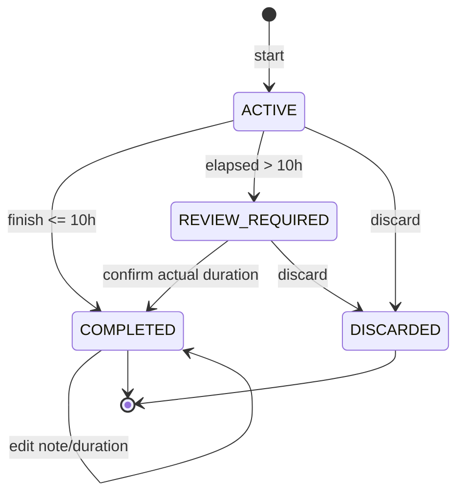

# Focus Reward — Sprint 2
## Focus Stopwatch → Review/Correction → XP → Character Level

**Sprint version:** 0.1  
**Date:** 2026-11-24  
**Source:** Domain/Solution Spec v0.3 + Implementation Plan v0.2  
**Prerequisite:** Sprint 1 completed and exit gate passed.

---

# 1. Sprint Outcome

At the end of Sprint 2, a real authenticated user must be able to:

1. start focus on an owned TRAINABLE skill with an ACTIVE goal;
2. keep the timer alive across refresh/reopen;
3. finish a normal session;
4. optionally correct actual focused duration;
5. receive XP equal to confirmed focused minutes;
6. see skill XP, character XP, level, and progress to next level;
7. recover a forgotten session that ran for more than 10 hours;
8. discard invalid sessions;
9. edit duration/note of a completed session;
10. be protected from duplicate finish and concurrent active-session races.

Core loop:

```text
ACTIVE GOAL
    ↓
START FOCUS
    ↓
WORK
    ↓
FINISH
    ↓
CONFIRMED TIME
    ↓
XP
    ↓
CHARACTER LEVEL
```

Reward money is **not** implemented in Sprint 2.

---

# 2. Scope Adaptation to Current Project State

The full spec allows focus through prerequisites, maintenance, and an optional progression quest. Those systems are later epics.

For Sprint 2 the start rule is intentionally:

```text
Authenticated user
+ owns skill
+ skill = TRAINABLE
+ skill not archived
+ skill has ACTIVE goal
+ no ACTIVE focus session
= focus may start
```

For this sprint:

```text
quest_id = not used
maintenance path = not implemented
prerequisite evaluation = not implemented
```

Do not build placeholder future domains just to satisfy the later design.

---

# 3. Definition of Done

A checkpoint is done only when:

- Flyway migration exists;
- JPA mapping validates against PostgreSQL;
- ownership is enforced;
- state transitions are enforced server-side;
- concurrency invariants have DB backstops where required;
- ProblemDetail uses stable error codes;
- integration tests use PostgreSQL/Testcontainers;
- UI supports the workflow;
- refresh/relogin does not corrupt state.

Server state is authoritative. The visible timer alone is not proof of correctness.

---

# 4. FocusSession Model

## Status

```text
ACTIVE
REVIEW_REQUIRED
COMPLETED
DISCARDED
```

## Fields

```text
id UUID
user_id UUID FK
skill_id UUID FK
status

started_at TIMESTAMPTZ
stopped_at TIMESTAMPTZ NULL

raw_elapsed_seconds INT NULL
confirmed_seconds INT NULL
credited_minutes INT NOT NULL DEFAULT 0

reward_eligible_snapshot BOOLEAN NOT NULL
reward_local_date DATE NOT NULL
timezone_snapshot VARCHAR NOT NULL

note TEXT NULL
corrected BOOLEAN NOT NULL DEFAULT FALSE
correction_note TEXT NULL

created_at TIMESTAMPTZ
updated_at TIMESTAMPTZ
version BIGINT
```

Do not add `quest_id` until the Quest epic unless there is a concrete migration reason to reserve it now.

The stopwatch stores `started_at`; the frontend calculates `now - started_at`. No backend ticks.

---

# 5. Checkpoint 1 — Persistence + DB Invariant

## Migration

Create the next Flyway migration for `focus_session`.

## Critical partial unique index

```sql
CREATE UNIQUE INDEX uq_focus_session_one_active_per_user
ON focus_session(user_id)
WHERE status = 'ACTIVE';
```

This is the final guard against two browser tabs starting simultaneously.

## Useful indexes

```sql
CREATE INDEX idx_focus_session_user_started
ON focus_session(user_id, started_at DESC);

CREATE INDEX idx_focus_session_skill_started
ON focus_session(skill_id, started_at DESC);

CREATE INDEX idx_focus_session_user_reward_date
ON focus_session(user_id, reward_local_date);
```

## Java

Create:

```text
FocusSession
FocusSessionStatus
FocusSessionRepository
```

Use `Instant`, `LocalDate`, and `@Version`.

## Tests

- migration applies;
- Hibernate validation passes;
- one ACTIVE persists;
- second ACTIVE for same user violates DB invariant;
- different users may each have one ACTIVE.

## Done when

PostgreSQL itself cannot persist two ACTIVE sessions for one user.

---

# 6. Checkpoint 2 — Start Focus

## API

```text
POST /api/v1/focus-sessions
```

Suggested request:

```json
{
  "skillId": "uuid",
  "note": "optional"
}
```

Never accept `userId`, `startedAt`, `status`, XP, or credited minutes from the client.

## Transaction

Conceptual flow:

```text
1. resolve authenticated user
2. normalize stale ACTIVE session if one exists
3. load skill with ownership
4. validate TRAINABLE
5. validate not archived
6. validate ACTIVE goal exists
7. verify no ACTIVE session remains
8. snapshot timezone/reward date/reward eligibility
9. persist ACTIVE session
```

At start:

```text
timezone_snapshot = current user timezone
reward_local_date = local date of started_at in that zone
reward_eligible_snapshot = skill.rewardEligible
```

Rewards are not calculated yet.

## Race handling

Two requests may both pass the service pre-check. Therefore:

```text
service validation
+
partial unique index
```

Translate only the named active-session constraint to:

```text
409 FOCUS_ALREADY_ACTIVE
```

Do not leak raw SQL/constraint details.

## Tests

- own TRAINABLE + ACTIVE goal succeeds;
- CATEGORY rejected;
- archived skill rejected;
- no ACTIVE goal rejected;
- another user's skill rejected;
- timezone snapshot correct;
- reward eligibility snapshot correct;
- sequential second start rejected;
- concurrent starts → exactly one ACTIVE survives.

---

# 7. Checkpoint 3 — Current Session + Persistent Timer

## API

```text
GET /api/v1/focus-sessions/current
```

If ACTIVE, return enough data for the UI:

```text
id
skillId
skillName
goal summary
status
startedAt
note
```

The frontend calculates elapsed locally.

## Stale normalization

Before returning current session or starting a new one:

```text
if ACTIVE and now - started_at > 10h:
    status = REVIEW_REQUIRED
    raw_elapsed_seconds = elapsed
    stopped_at = now
```

No XP is awarded.

Exactly 10h is still normal. Only `> 10h` requires review.

## Tests

- refresh-style second GET returns same startedAt;
- exactly 10h remains ACTIVE;
- >10h becomes REVIEW_REQUIRED;
- normalization persists;
- REVIEW_REQUIRED no longer blocks a new ACTIVE session.

---

# 8. Checkpoint 4 — Finish Normal Session

## API

```text
POST /api/v1/focus-sessions/{id}/finish
```

Suggested request:

```json
{
  "confirmedSeconds": null,
  "note": "optional"
}
```

`null` means use raw elapsed.

## Finish transaction

Lock the session row for write.

```text
1. load by id + authenticated user with write lock
2. COMPLETED → return existing completed result (idempotent)
3. DISCARDED → conflict
4. REVIEW_REQUIRED → use review endpoint
5. calculate raw elapsed
6. raw >10h → REVIEW_REQUIRED, no credit
7. otherwise confirmed = supplied correction OR raw
8. validate 0..36000 seconds
9. credited_minutes = floor(confirmed_seconds / 60)
10. status = COMPLETED
11. stopped_at = now
12. persist and return progression summary
```

## Boundaries

```text
59 sec  → 0 XP
60 sec  → 1 XP
119 sec → 1 XP
120 sec → 2 XP
36000 sec → valid
>36000 sec → invalid
```

## Tests

- normal finish;
- corrected finish;
- 0 sec;
- 59/60/119/120 boundaries;
- >36000 rejected;
- duplicate finish idempotent;
- other user cannot finish;
- discarded cannot finish;
- >10h becomes REVIEW_REQUIRED.

---

# 9. Checkpoint 5 — REVIEW_REQUIRED + Discard

## APIs

```text
POST /api/v1/focus-sessions/{id}/review
POST /api/v1/focus-sessions/{id}/discard
```

## Review

Request:

```json
{
  "confirmedSeconds": 5400,
  "correctionNote": "Forgot to stop"
}
```

Valid duration:

```text
0..36000 seconds
```

Transition:

```text
REVIEW_REQUIRED → COMPLETED
```

Set corrected=true and recalculate credited minutes.

## Discard

Allowed:

```text
ACTIVE → DISCARDED
REVIEW_REQUIRED → DISCARDED
```

No XP.

A REVIEW_REQUIRED session must **not** block a new focus session.

## Tests

- stale → review;
- review valid duration;
- exactly 600 min accepted;
- >600 min rejected;
- discard ACTIVE;
- discard REVIEW_REQUIRED;
- discarded gives zero XP;
- unresolved REVIEW_REQUIRED does not block new ACTIVE.

---

# 10. Checkpoint 6 — Correct Completed Session

## API

```text
PATCH /api/v1/focus-sessions/{id}
```

Editable only:

```text
confirmedSeconds?
note?
correctionNote?
```

Never PATCH:

```text
status
user
skill
startedAt
rewardLocalDate
timezoneSnapshot
rewardEligibleSnapshot
```

Only COMPLETED sessions may have their completed duration corrected.

If duration changes:

```text
credited_minutes = floor(newConfirmedSeconds / 60)
corrected = true
```

Carry forward the Sprint 1 PATCH rule:

```text
omitted = unchanged
supplied invalid value = validation error
```

Do not reuse an inappropriate create DTO.

## Tests

- note-only edit keeps XP;
- duration increase changes XP;
- duration decrease changes XP;
- correction to zero removes that session's XP;
- ACTIVE/DISCARDED cannot be abused through PATCH;
- ownership enforced.

---

# 11. Checkpoint 7 — XP as Derived Data

Authoritative source:

```text
FocusSession.status = COMPLETED
FocusSession.credited_minutes
```

Do NOT create:

```text
skill.xp
user.character_xp
xp_transaction
```

## Skill XP

```text
SUM(credited_minutes)
WHERE skill_id = ?
AND status = COMPLETED
```

## Character XP

```text
SUM(credited_minutes)
WHERE user_id = ?
AND status = COMPLETED
```

## Category XP

Derived display aggregate over descendant TRAINABLE skills only.

It must not create additional character XP.

## APIs

```text
GET /api/v1/progress/character
GET /api/v1/skills/{skillId}/progress
GET /api/v1/paths/{pathId}/progress
```

## Tests

- COMPLETED contributes;
- ACTIVE/REVIEW_REQUIRED/DISCARDED contribute zero;
- correction changes totals;
- two skills sum once into character XP;
- category aggregation does not double count;
- ownership isolation.

---

# 12. Checkpoint 8 — CharacterLevelCalculator

Create one pure service:

```text
CharacterLevelCalculator
```

No HTTP, JPA, repository, or security inside it.

## Constants

```text
MAX_LEVEL = 100
MAX_XP = 600000
K = 0.05
```

## Threshold

```text
threshold(L) =
round(
    600000 *
    (exp(0.05 * (L - 1)) - 1)
    /
    (exp(0.05 * 99) - 1)
)
```

## Level

```text
level(xp) = max L where threshold(L) <= xp
```

For `xp >= 600000`, visual level remains 100 while lifetime XP continues increasing.

## Fixed tests

```text
L1   = 0
L2   = 219
L5   = 948
L10  = 2433
L20  = 6787
L50  = 45322
L90  = 362234
L99  = 570529
L100 = 600000
```

Also test:

- monotonic thresholds;
- XP 0 → L1;
- XP 218 → L1;
- XP 219 → L2;
- XP 600000 → L100;
- XP >600000 → L100;
- no progress-percentage division issue at L100.

---

# 13. Checkpoint 9 — UI Daily Loop

Extend the existing UI. Do not redesign the application shell.

## Skill action

For TRAINABLE + ACTIVE goal:

```text
[ Start Focus ]
```

Without ACTIVE goal, show why focus cannot start.

## Persistent running-session surface

At minimum:

```text
Skill name
Goal
Elapsed HH:MM:SS
Finish
Discard
```

The current timer should remain visible when navigating away from the skill.

## Finish dialog

Show:

```text
raw duration
actual focused duration
optional note
```

Default actual = raw.

## Completion result

Show:

```text
Focused: 74 min
XP gained: +74
Skill XP
Character XP
Level
Progress to next level
```

## REVIEW_REQUIRED UI

Show stale session separately with:

```text
started time
raw elapsed
enter actual duration
discard
```

It must not block starting a new session.

## Progress UI

Minimum:

```text
Character Level
Lifetime XP
Level progress bar
Skill focused minutes / XP
```

No fancy animation requirement.

---

# 14. Checkpoint 10 — Errors + Cleanup

Required focus errors:

```text
FOCUS_ALREADY_ACTIVE
FOCUS_NOT_ACTIVE
FOCUS_REVIEW_REQUIRED
INVALID_FOCUS_DURATION
INVALID_FOCUS_TRANSITION
ACTIVE_GOAL_REQUIRED
SKILL_NOT_TRAINABLE
INVALID_TIMEZONE
```

Keep the existing project convention for 404 ownership/resource errors consistently.

Translate only known named DB constraints. Never expose SQL or raw PostgreSQL details.

Cleanup review:

- no controller business logic;
- no XP mutation fields;
- no timer tick writes;
- write lock/state protection on finish/review/correction;
- ownership scope on every session operation;
- PATCH semantics correct;
- timezone/reward snapshots immutable;
- full `mvn clean test` green.

---

# 15. Concurrency Cases

## Race A — two starts

```text
Tab A → start
Tab B → start
```

Expected:

```text
1 ACTIVE
1 FOCUS_ALREADY_ACTIVE
```

Protection:

```text
service pre-check + partial unique DB index
```

## Race B — duplicate finish

```text
Request A → finish
Request B → finish same session
```

Expected:

```text
one transition
same final XP
no duplicate credit
```

Use row locking + idempotent COMPLETED handling.

---

# 16. State Machine



`COMPLETED` and `DISCARDED` never return to ACTIVE.

---

# 17. Mandatory Test Groups

## Start

```text
start_success
start_category_rejected
start_without_active_goal_rejected
start_other_user_skill_rejected
start_second_active_rejected
start_concurrent_only_one_survives
```

## Current / stale

```text
current_active_returns_same_started_at
current_exactly_10h_still_active
current_over_10h_normalizes_to_review
review_required_does_not_block_new_start
```

## Finish

```text
finish_success
finish_59s_zero_xp
finish_60s_one_xp
finish_corrected_duration
finish_over_10h_requires_review
finish_duplicate_is_idempotent
finish_other_user_rejected
```

## Review / discard

```text
review_to_completed
review_max_600min
review_over_600min_rejected
discard_active
discard_review
discarded_zero_xp
```

## Correction

```text
completed_duration_increase_changes_xp
completed_duration_decrease_changes_xp
completed_note_only_keeps_xp
```

## Progress

```text
skill_xp_derived_from_completed
character_xp_sums_sessions_once
inactive_states_zero_xp
category_aggregate_no_double_count
```

## Level calculator

Pure unit tests:

```text
known_thresholds
boundary_levels
monotonicity
level_100_cap
```

---

# 18. Sprint 2 Exit Test

Run through the normal UI.

No manual SQL repair. No disabling security.

## 1. Prepare

Use a TRAINABLE skill with ACTIVE goal.

## 2. Start

Start focus.

Expected: timer begins.

## 3. Persistence

Reload and navigate away/back.

Expected: same session and same `startedAt`; elapsed continues.

## 4. Double start

Try to start another session in another tab.

Expected: one ACTIVE only; second start rejected.

## 5. Normal finish

Finish and correct actual duration to 5 minutes.

Expected:

```text
COMPLETED
+5 XP
skill XP +5
character XP +5
```

## 6. Duplicate finish

Retry finish for same session.

Expected: still +5 total, not +10.

## 7. Correction

Edit completed duration:

```text
5 min → 3 min
```

Expected: skill/character XP decrease by 2.

## 8. Minute boundary

Confirm one session as 59 seconds → 0 XP.

Confirm another as 60 seconds → 1 XP.

## 9. Forgotten timer

Through a legitimate dev/test fixture, create an ACTIVE session with elapsed `>10h`.

Expected:

```text
REVIEW_REQUIRED
0 automatic XP
```

## 10. Continue despite review

With unresolved REVIEW_REQUIRED, start a new focus session.

Expected: allowed.

## 11. Resolve review

Enter actual focused duration = 90 minutes.

Expected: old session → COMPLETED and +90 XP.

## 12. Discard

Start and discard another session.

Expected: DISCARDED and 0 XP.

## 13. Relogin

Sign out/in.

Expected: history, XP, and level remain correct.

## 14. Ownership

Second user cannot read, finish, correct, or discard first user's sessions and does not receive their XP.

---

# 19. Sprint PASS Criteria

Sprint passes only when both are true:

```text
one ACTIVE stopwatch per user
```

is guaranteed under concurrency,

and:

```text
XP = SUM(COMPLETED credited_minutes)
```

is reproducible from persisted sessions.

The full UI loop must work:

```text
start
→ refresh
→ finish
→ XP
→ level
→ correction
→ review recovery
```

---

# 20. Explicitly Not in Sprint 2

Do not implement:

- reward earning/balance/shop;
- prerequisites;
- mastery;
- progression quests;
- side quests;
- weekly quest selection;
- maintenance;
- templates;
- export;
- AI;
- notifications;
- achievements/cosmetics.

Snapshot fields required by later reward logic are allowed.

---

# 21. Suggested Commits

```text
feat(focus): add focus session persistence and active-session invariant
feat(focus): implement start and current-session recovery
feat(focus): implement finish review discard lifecycle
feat(focus): support completed-session corrections
feat(progress): derive skill and character xp
feat(progress): add character level calculator
feat(ui): add persistent stopwatch and review flow
test(focus): add lifecycle concurrency and ownership coverage
```

---

# 22. Learning Targets

By the end of Sprint 2 you should be able to explain from your own code:

- why stopwatch state stores `started_at` instead of ticks;
- why one ACTIVE session needs both service validation and DB partial uniqueness;
- why finish must be idempotent;
- why row locking matters on transitions;
- why XP is derived instead of stored as a mutable balance;
- why `credited_minutes` is persisted even though XP is derived;
- why timezone/reward eligibility are snapshotted before reward implementation;
- raw elapsed vs confirmed duration;
- why >10h becomes REVIEW_REQUIRED;
- why REVIEW_REQUIRED does not block a new timer;
- optimistic `@Version` vs explicit pessimistic locking;
- why level calculation belongs in a pure service.

---

# 23. Immediate First Task

Start only with:

```text
FocusSession migration
+ FocusSession entity
+ FocusSessionStatus
+ repository
+ partial unique ACTIVE-per-user index
+ schema/invariant integration tests
```

Do not start from the timer UI.

First proof:

```text
PostgreSQL physically cannot persist
2 ACTIVE focus sessions for one user.
```

Only after that implement `POST /focus-sessions`.
